# 🏛️ FoodRescue — Architecture & Flowcharts

This document details the system architecture, component topology, sequence flowcharts, verification pipelines, and entity relationships of the **FoodRescue** platform.

---

## 1. High-Level System Topology & Tier Architecture

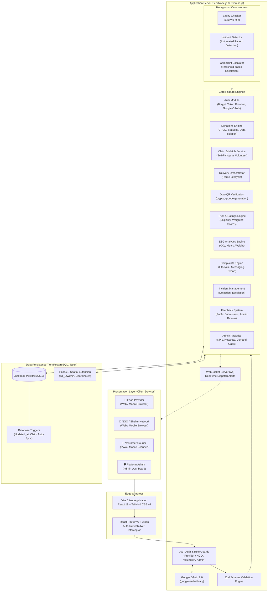

---

## 2. End-to-End Food Rescue Lifecycle Flowchart

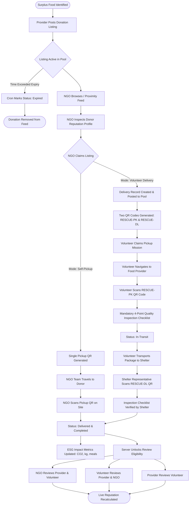

---

## 3. Authentication & Google OAuth Flow

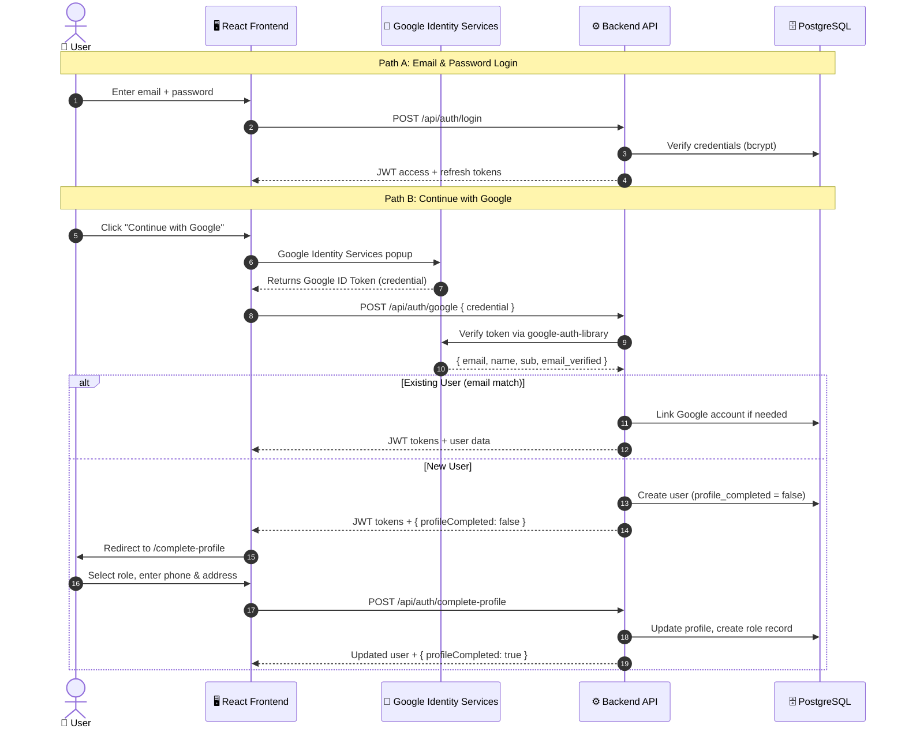

---

## 4. Dual-QR Code Verification Pipeline

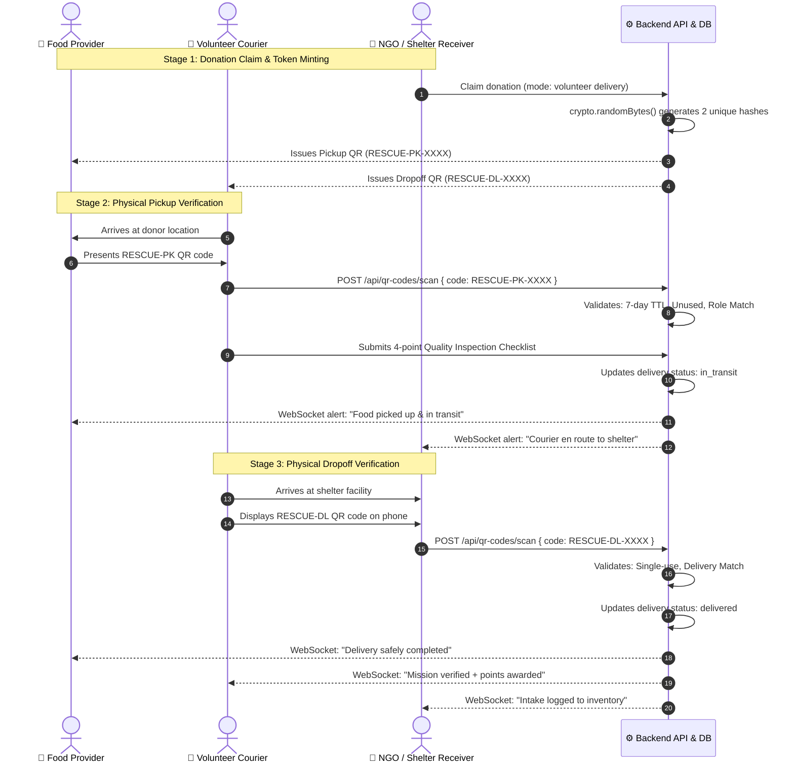

---

## 5. Trust, Ratings & Reliability Engine Architecture

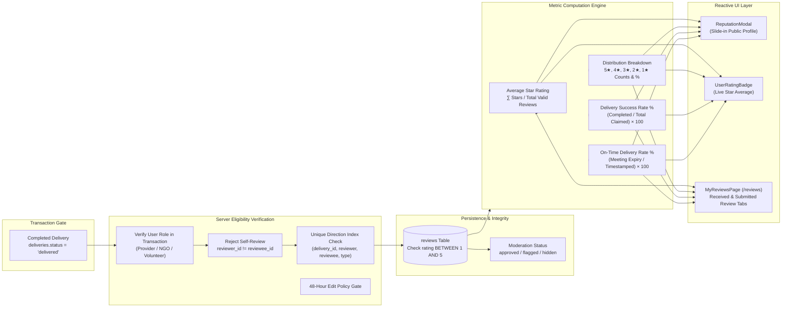

---

## 6. Complaint & Incident Resolution Architecture

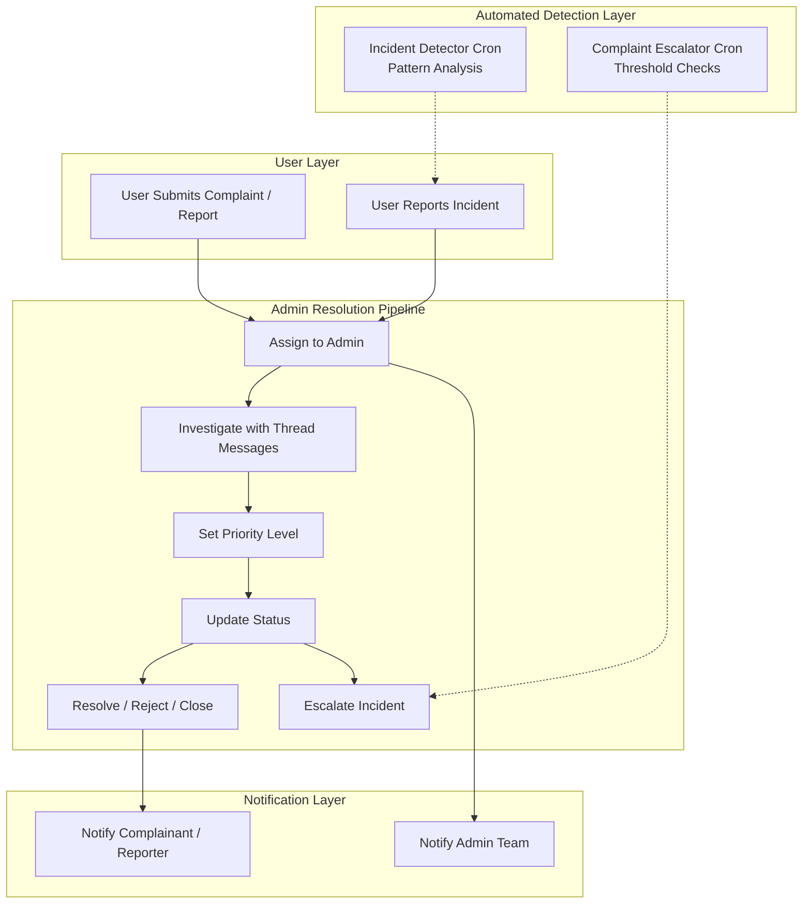

---

## 7. Relational Database Architecture (Entity Relationship Diagram)

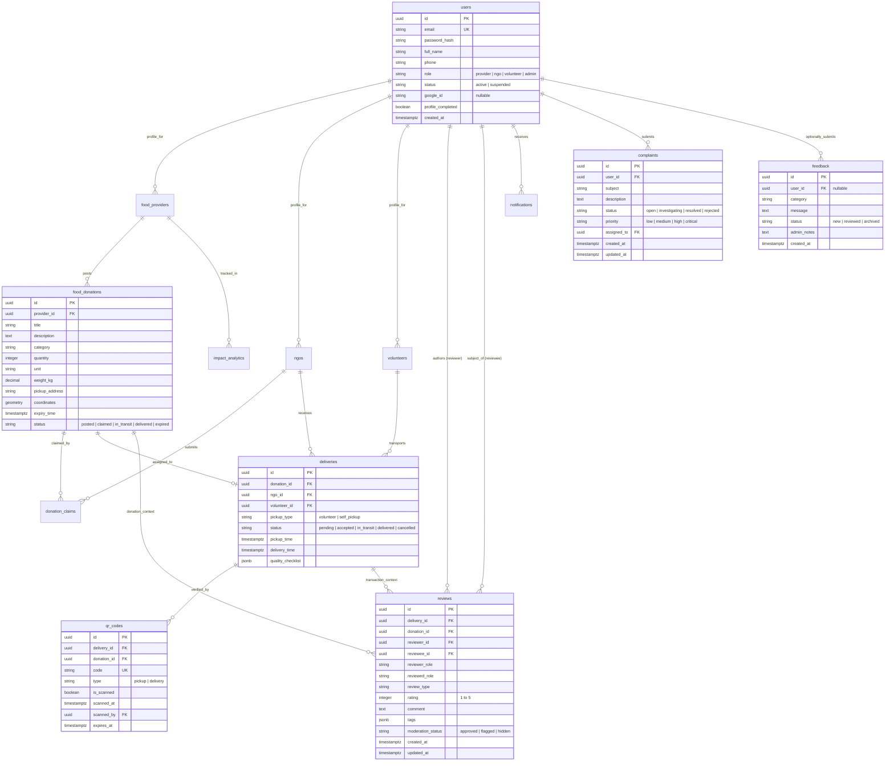

---

## 8. Automated Expiry & Background Scheduling Flow

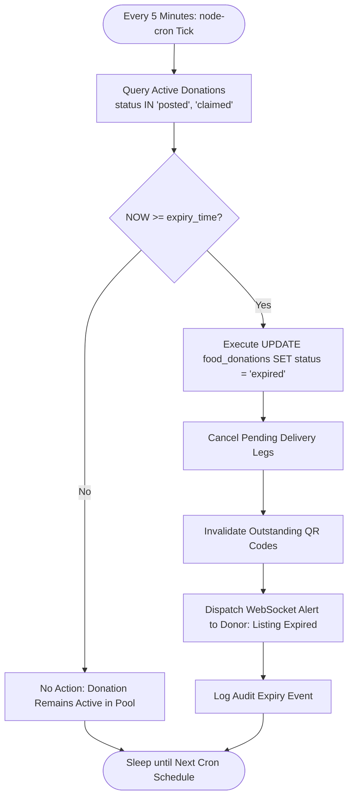

---

## 9. Frontend Component Hierarchy & Global State Topology

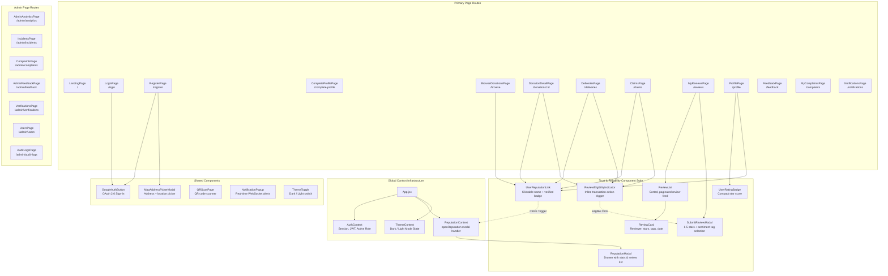

---

## 10. Data Isolation & Role-Based Access Control

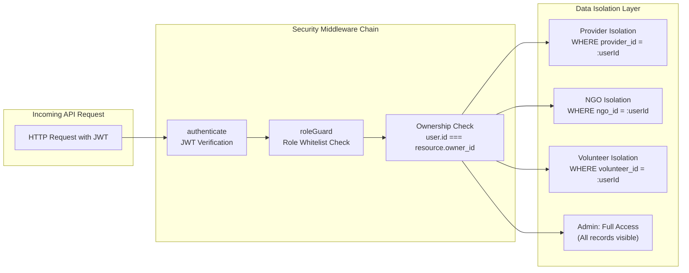

---

## 11. Notification Isolation Architecture

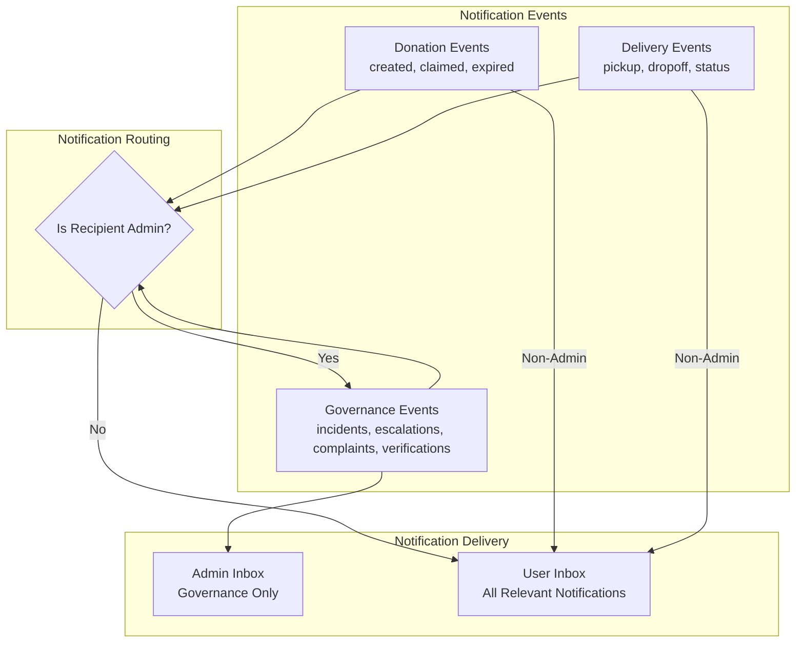

---

## 12. Continuous Integration & Verification Pipeline

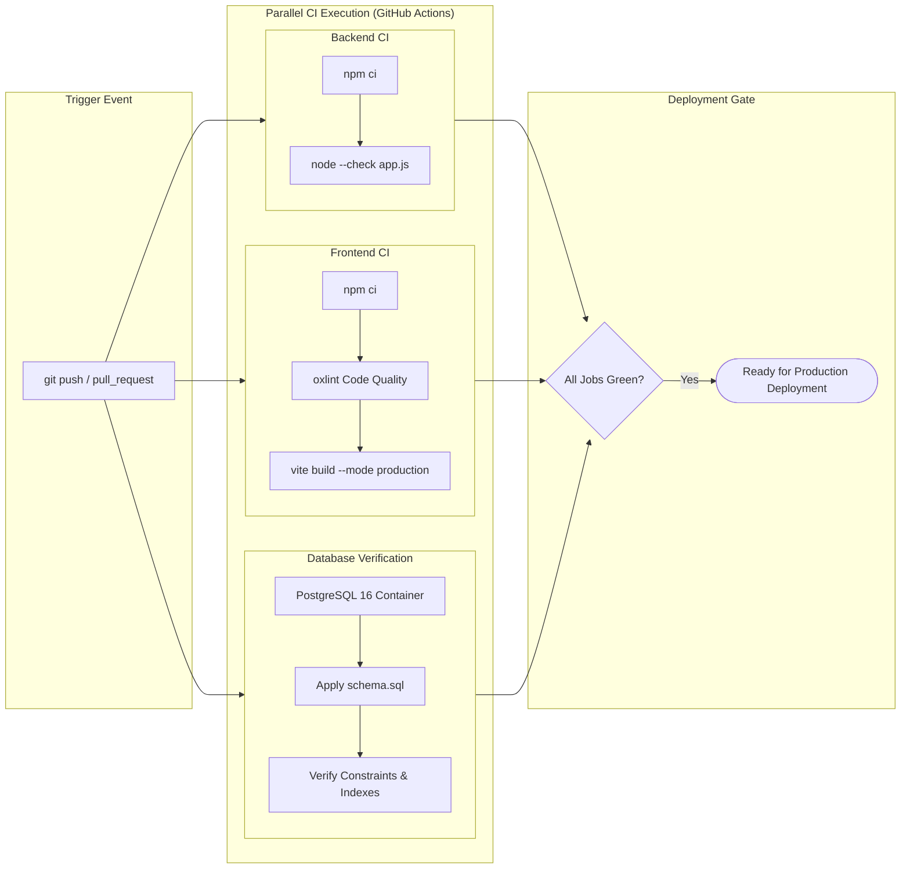
